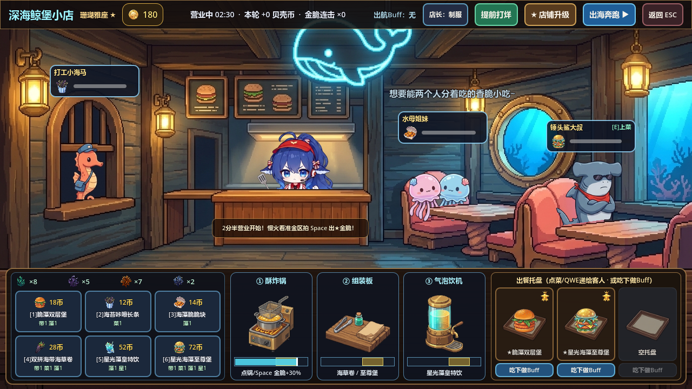
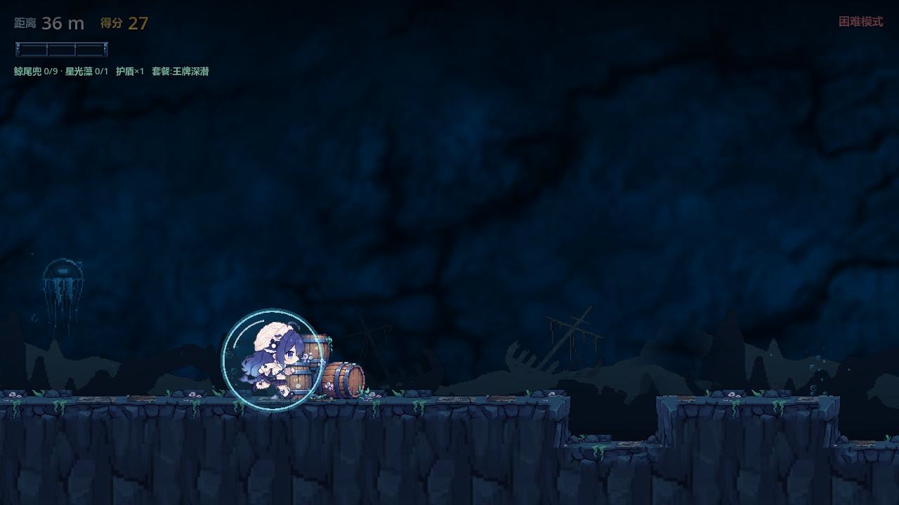

# 大肥鱼快跑（Chubby Whale Run）

一款使用 **Godot 4.7.2** 开发的深海像素风 2D 横版动作跑酷 × 餐厅经营休闲游戏。玩家操控深海蓝鲸娘在沉船礁石与断桥海沟间跳跃、滑铲，采集深海植物、攒满势能发动冲刺正面破障破弹，甩开二阶段「红转黑」狂暴黑鲸娘的围猎；回到水面还能经营**深海鲸堡小店**，烹制金脆料理招待海洋顾客并换取开局 Buff 与装潢升级。

> **Windows 玩家可直接试玩**：前往 [Releases 最新版本](https://github.com/jiuhua2026/chubby_whale_run/releases) 下载单文件可执行程序 `大肥鱼快跑.exe`，双击即可运行（无需安装 Godot）。

---

## 游戏展示

<p align="center">
  
  <br />
  <sub>困难模式实机：黑鲸娘红转黑锁血狂暴、三高度暗影弹幕与正面 Space 破弹反击</sub>
</p>

| 新版主菜单（出海 / 小店 / 换装 / 设置） | 深海鲸堡小店经营（★金脆上菜） | 暖冬针织 × 大水泡护盾破障 |
| :---: | :---: | :---: |
|  |  |  |

---

## 游戏特色

- **极简三键 ＋ 正面破障破弹**：以 `↑` 跳跃 / `↓` 滑铲与「擦身而过（Near Miss）」积攒 3 格势能为核心，按 `Space` 发动深海冲刺即可**正面击碎木桶障碍、弹反黑鲸娘虚空能量弹掉落星光藻**，还可配合小店增益或护盾抵挡一次撞击。
- **双难度海域与「红转黑」狂暴 Boss 战**：除**常规模式**外新增**困难模式（+20% 得分加成）**——黑鲸娘进入二阶段红转黑锁血狂暴，伴随赤红激光预警发射三高度暗影弹幕与贴身扑杀。
- **深海采植 × 鲸堡小店经营闭环**：跑酷沿途采集**嫩海带 / 深海紫菜 / 脆海藻 / 星光藻**（鲸尾兜收纳）；在**鲸堡小店**现场点单烹饪 6 道海味餐点、把握进度条高光区拍出 `★金脆`，招待海马、水母姐妹、锤头鲨大叔及神秘**「乔装黑鲸娘」**赚取贝壳币升级厨具装潢，也可赛前试吃带上强力 Buff 出海。
- **换装衣橱与 26 项成就图鉴**：内置 **26 项成就**与 **6 张精绘纪念画片**，支持在**「深海女仆」**与**「暖冬针织」**两套完整实机动作皮肤间自由切换。
- **可解性校验程序化地形与双总线音频**：`TerrainComposer`、`TerrainGenerator` 与 `Solvability` 协同生成并校验平地、凹凸台阶、高低断桥与沉船障碍；`BGM` / `SFX` 独立音频总线在暂停与结算时自动切入水下低通滤波，并支持开场动画演出与重温。

---

## 操作说明

### 跑酷阶段
| 操作 | 按键 | 说明 |
| --- | --- | --- |
| **跳跃** | `↑` | 越过贴地障碍、跨过深沟或跳上高台；松开按键可控制跳跃高度 |
| **下滑 / 速降** | `↓` | 钻过悬顶障碍；空中按下可快速下落 |
| **深海冲刺 / 破障破弹** | `Space` | 攒满 3 格势能后释放，获得短时加速、无敌、正面碎障与弹反虚空弹能力 |
| **暂停 / 返回** | `ESC` | 跑酷中打开暂停面板；结算或测试模式返回主菜单 |
| **快速重开** | `R` | 死亡结算面板出现后快速重新开始 |

### 鲸堡小店快捷键
| 操作 | 按键 | 说明 |
| --- | --- | --- |
| **点单下单** | `1` ~ `6` | 快速制作 6 道海味菜品（也可鼠标直接点击菜单） |
| **拍出 ★金脆** | `Space` | 在厨具进度条蓝色高光区按下，触发金脆加成与额外贝壳币 |
| **一键上菜** | `Q` / `W` / `E` | 分别对应左外卖窗、右左卡座、右右卡座快捷送餐 |
| **返回主菜单** | `ESC` | 结束或退出小店面板 |

> 支持以下游玩模式：**常规模式**（完整追逐与采植体验）、**困难模式**（红转黑狂暴 Boss 弹幕战，+20% 得分加成）、**练习模式**（关闭追逐，专注地形跑酷）以及 **测试模式**（平坦观察路面，支持 `,` / `.` 实时调速）。

---

## 本地运行与打包

### 环境要求
- **Godot Engine 4.7.2**（Forward+）
- 如需运行本地打包、音效生成或宣传素材脚本：Python 3 + `Pillow` / `numpy` / `scipy` / `imageio-ffmpeg`（仅工具脚本需要，游玩或编辑器运行无需 Python）

### 运行方式
1. 克隆本仓库：
   ```bash
   git clone https://github.com/jiuhua2026/chubby_whale_run.git
   cd chubby_whale_run
   ```
2. 使用 **Godot 4.7.2** 打开根目录的 `project.godot`，点击运行即可游玩。

### 导出 Windows 单文件 exe
确保已安装 Godot 4.7.2 对应版本的 Windows 导出模板后，运行：
```bash
python tools/build_launcher.py --godot "<你的 Godot 控制台版 exe 路径>"
```
导出结果将输出到 `dist/大肥鱼快跑/大肥鱼快跑.exe`（资源内嵌的单文件可执行程序）。

### 命令行自检（开发者用）
```bash
# 暂停 / 恢复流程自检
godot --headless --path . -- --pause-demo

# 死亡重开与防误触延迟自检
godot --headless --path . -- --restart-demo

# Boss 狂暴弹幕、植物采集、小店 Buff 与 26 项成就回归自检
godot --headless --path . -- --phase1-demo
godot --headless --path . -- --phase2-demo
godot --headless --path . -- --achievements-demo

# 开启自动驾驶纯可解性验证与地形导出
godot --headless --fixed-fps 60 --quit-after 2400 --path . -- --selftest --solvable --dump-terrain
```

---

## 目录结构

```text
chubby_whale_run/
├── audio/                 # 游戏 BGM 与 SFX（含 .import）
├── media/                 # README 展示截图与实机动图（含 .gdignore）
├── scenes/                # 主场景与玩家场景（Main.tscn / Player.tscn）
├── scripts/               # 全部 GDScript 源码（autoload / main / player / chase / world / shop / ui / fx / dev）
├── sprites/               # 角色皮肤、追兵狂暴/弹幕、地形障碍、小店场景与 UI 图标
├── tools/                 # 打包、音频生成、素材切图、PV 合成与地形验证脚本
├── export_presets.cfg     # Godot Windows 导出预设
├── project.godot          # Godot 工程主配置
├── LICENSE                # MIT 开源协议
└── README.md
```

---

## 开源协议与素材说明

- **源码协议**：本项目代码部分采用 [MIT License](LICENSE) 开源。
- **音频素材**：`audio/bgm/` 中的跑酷/追击/菜单配乐及 `audio/sfx/` 下的 CC0 替换音效采用 **CC0 1.0 公共领域授权**；`audio/bgm/bgm_shop.wav`（`tools/make_bgm_shop.py`）与其余程序合成提示/小店音效（`tools/make_sfx.py`）随项目一并提供。
- **字体**：界面文本直接采用 Godot 默认系统字体回退渲染，未打包第三方受限字体文件。
- **美术素材**：除上述说明外，项目内原创像素角色、皮肤、Boss、小店与 UI 图像素材版权归作者所有（二次分发或商用请保留署名或遵循仓库协议要求）。
