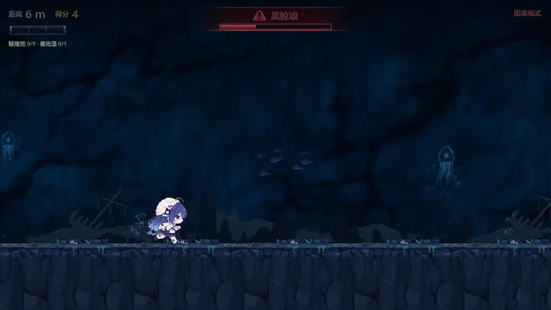
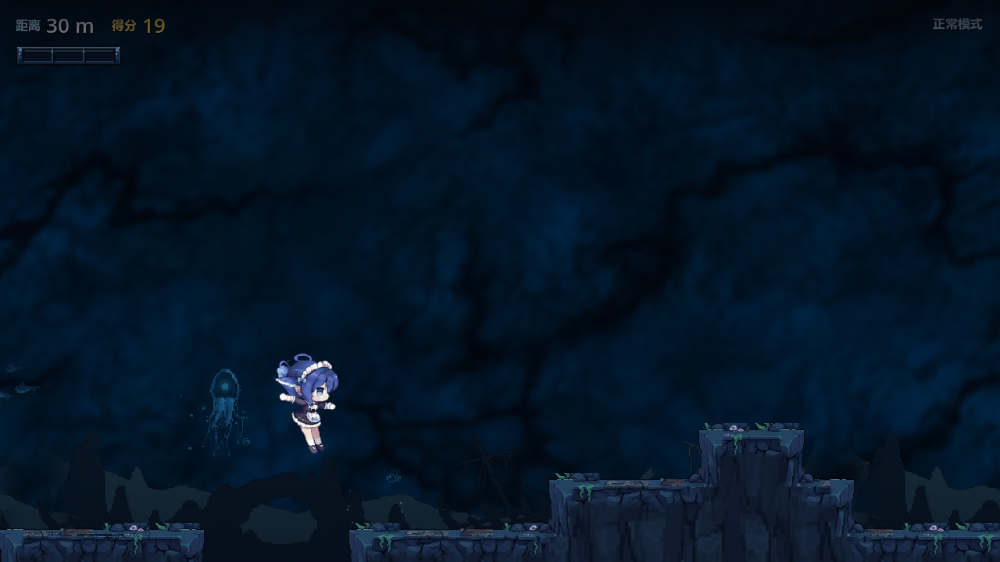
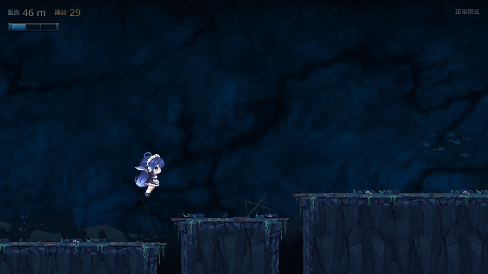

# 大肥鱼快跑（Chubby Whale Run）

一款使用 **Godot 4.7.2** 开发的深海像素风 2D 横版休闲跑酷游戏。玩家操控深海蓝鲸娘在海底礁石与沉船遗迹间跳跃、滑铲，并通过擦身而过积攒势能发动冲刺，甩开身后的黑鲸娘追击与死亡边界。

> **Windows 玩家可直接试玩**：前往 [Releases 最新版本](https://github.com/jiuhua2026/chubby_whale_run/releases) 下载 `chubby_whale_run.exe`，双击即可运行（无需安装 Godot）。

---

## 游戏展示

<p align="center">
  
  <br />
  <sub>黑鲸娘贴身追击：越过沉船木桶堆与地形凹坑</sub>
</p>

| 主菜单界面 | 阶梯凹凸地形 | 高低断桥飞跃 |
| :---: | :---: | :---: |
|  |  |  |

---

## 游戏特色

- **极简直观的跑酷操作**：以「跳跃 / 下滑」为核心操作，结合「擦身而过（Near Miss）」积攒 3 格势能并释放无敌冲刺，兼顾休闲手感与风险回报。
- **可解性校验驱动的程序化地形**：由 `TerrainComposer`、`TerrainGenerator` 与 `Solvability` 协同生成，包含深海平地、凹凸起伏台阶（1~2 级紧凑凸峰与凹谷）、高低错落断桥以及沉船/礁岩障碍，并通过规则校验与 `--solvable` 自动巡航验证确保每段地形均可合法通过。
- **双段式压迫体验**：常态推进由后方死亡边界维持节奏；触发高潮段时，黑鲸娘将伴随预警与专属主题地形展开近身追逐。
- **完整音频与界面系统**：独立 `BGM` / `SFX` 音频总线（暂停及结算时自动平滑切入水下低通滤波）、开场动画演出、主菜单 / 暂停面板 / 设置面板（含音乐音量、音效音量、屏幕震动、全屏/窗口显示模式及主菜单开场动画重温）。

---

## 操作说明

| 操作 | 按键 | 说明 |
| --- | --- | --- |
| **跳跃** | `↑` | 越过贴地障碍、跨过深沟或跳上高台台阶；松开按键可控制跳跃高度 |
| **下滑 / 速降** | `↓` | 钻过悬顶障碍；空中按下可快速下落 |
| **冲刺** | `Space` | 擦身躲避障碍攒满 3 格势能后释放，获得短时加速与无敌保护 |
| **暂停 / 返回** | `ESC` | 正常/练习模式中打开暂停面板；结算或测试模式返回主菜单 |
| **快速重开** | `R` | 死亡结算面板出现后快速重新开始 |

> 支持以下游玩模式：**正常模式**（完整追逐体验）、**练习模式**（关闭黑鲸娘追逐，专注于地形跑酷）以及 **测试模式**（平坦观察路面，支持 `,` / `.` 实时调速）。

---

## 本地运行与打包

### 环境要求
- **Godot Engine 4.7.2**（Forward+）
- 如需运行本地打包脚本或工具脚本：Python 3 + `Pillow` / `numpy` / `scipy`（仅切图与工具脚本需要，游玩/编辑器运行无需 Python）

### 运行方式
1. 克隆本仓库：
   ```bash
   git clone https://github.com/jiuhua2026/chubby_whale_run.git
   cd chubby_whale_run
   ```
2. 使用 **Godot 4.7.2** 打开根目录的 `project.godot`，点击运行即可游玩。

### 导出 Windows 单文件 exe
确保已安装 Godot 4.7.2 对应版本的 Windows 导出模板后，运行：
```bash
python tools/build_launcher.py --godot "<你的 Godot 控制台版 exe 路径>"
```
导出结果将输出到 `dist/大肥鱼快跑/大肥鱼快跑.exe`（资源内嵌的单文件可执行程序）。

### 命令行自检（开发者用）
```bash
# 暂停 / 恢复流程自检
godot --headless --path . -- --pause-demo

# 死亡重开与防误触延迟自检
godot --headless --path . -- --restart-demo

# 开启自动驾驶纯可解性验证与地形导出
godot --headless --fixed-fps 60 --quit-after 2400 --path . -- --selftest --solvable --dump-terrain
```

---

## 目录结构

```text
chubby_whale_run/
├── audio/                 # 游戏 BGM 与 SFX（含 .import）
├── media/                 # README 展示截图与实机动图（含 .gdignore）
├── scenes/                # 主场景与玩家场景（Main.tscn / Player.tscn）
├── scripts/               # 全部 GDScript 源码（autoload / main / player / chase / world / ui / fx / dev）
├── sprites/               # 角色、追兵、地形、障碍、UI、特效与图标（sprites/icon/）
├── tools/                 # 打包脚本、地形统计与素材处理工具
├── export_presets.cfg     # Godot Windows 导出预设
├── project.godot          # Godot 工程主配置
├── LICENSE                # MIT 开源协议
└── README.md
```

---

## 开源协议与素材说明

- **源码协议**：本项目代码部分采用 [MIT License](LICENSE) 开源。
- **音频素材**：`audio/bgm/` 下的 3 首背景音乐以及 `audio/sfx/` 下的 CC0 替换音效均采用 **CC0 1.0 公共领域授权**；其余由 `tools/make_sfx.py` 程序生成的过渡/提示音效随项目一并提供。
- **字体**：界面文本直接采用 Godot 默认系统字体回退渲染，未打包第三方受限字体文件。
- **美术素材**：除上述说明外，项目内原创像素角色、场景与 UI 图像素材版权归作者所有（二次分发或商用请保留署名或遵循仓库协议要求）。
